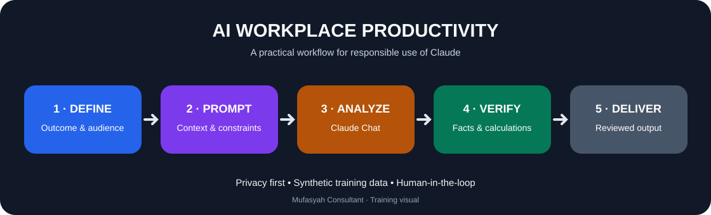
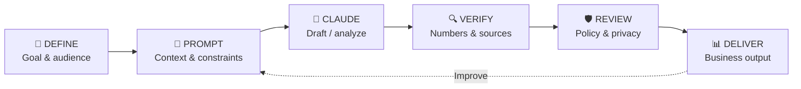

<div align="center">

# iFAST | AI Workplace Productivity

### Practical AI training · Claude & Microsoft Copilot

 &nbsp;&nbsp; 

*Brand icons are used for product identification only.*

  

**Training resources prepared by [Mufasyah Consultant](https://mufasyah.com)**

</div>

> [!IMPORTANT]
> **iFAST training environment:** Hands-on exercises use **Claude only**. Microsoft Copilot is included **for learning and official reference**, not as a required training tool. No APIs, extensions, installations, external automation or integrations are necessary. Use **fictional scenarios and synthetic data only**. Follow iFAST's internal AI, information-security and compliance policies. Do not upload actual client records, personal data, confidential financial information or internal documents without authorization.

## 🧭 Quick navigation

- [🎯 Training objectives](#-training-objectives)
- [🧩 AI productivity infographic](#-ai-productivity-infographic)
- [🛠️ Claude-only workplace activities](#️-claude-only-workplace-activities)
- [📝 Reusable prompting framework](#-reusable-prompting-framework)
- [📚 Microsoft Copilot references](#-microsoft-copilot-official-references)
- [📘 Claude references](#-claude-official-references)
- [🛡️ Responsible AI](#️-responsible-ai-checklist)
- [🏆 Group challenge](#-group-challenge)

## 🎯 Training objectives

Participants will learn to **write effective prompts**, summarize and analyze business information, assess hypothetical risks, communicate findings to decision makers, and **verify AI outputs** before use. The materials are suitable for professional functions including operations, customer service, reporting, risk and compliance, and management.

## 🧩 AI productivity infographic

**AI-assisted workplace productivity cycle — trainer-created learning infographic**



The SVG above is an original, reusable training infographic. The interactive flow diagram below is the text-accessible companion.



**Four high-value workplace use cases**

| 📊 Analyze | 📄 Summarize | 🧠 Decide | 🛡️ Validate |
|:---:|:---:|:---:|:---:|
| KPI trends and anomalies | Long reports and policy text | Options and trade-offs | Facts, arithmetic and unsupported claims |
| **Output:** executive insights | **Output:** concise briefing | **Output:** decision matrix | **Output:** QA checklist |

## 🛠️ Claude-only workplace activities

Each activity can be completed in **Claude Chat** using only fictional or synthetic information. These exercises deliberately **do not repeat Scheduling or Application Building**.

| # | Activity | Time | Deliverable |
|---|---|---:|---|
| 1 | 📊 Financial Performance Analysis | 30 min | KPI summary, trends and management insights |
| 2 | 🛡️ Compliance Risk Simulation | 30 min | Hypothetical risk matrix and escalation rationale |
| 3 | 💬 Customer Complaint Role-play | 20 min | Professional response and escalation notes |
| 4 | 📄 Policy Comparison & Gap Analysis | 30 min | Change-impact and gap summary |
| 5 | ⚖️ Business Decision Matrix | 30 min | Evidence-based comparison of options |
| 6 | 🔍 AI Quality Assurance Audit | 25 min | Error log and corrected calculations |
| 7 | 📣 Executive Briefing | 25 min | One-page management summary |
| 8 | 🧠 Hallucination Detection Challenge | 25 min | Supported vs unsupported claims |

<details>
<summary><strong>📊 Copy-ready prompt: Financial Performance Analysis</strong></summary>

```text
Act as a financial performance analyst for a fictional financial-services company.
Create a clearly labelled synthetic 12-month dataset with revenue, operating
cost, transaction volume and active customers. Show all calculation formulas
and a KPI table. Identify three trends and two anomalies. Prepare an executive
briefing with evidence-based recommendations. Do not present fictional
figures as actual iFAST results. State assumptions and limitations.
```
</details>

<details>
<summary><strong>🛡️ Copy-ready prompt: Compliance Risk Simulation</strong></summary>

```text
Act as a facilitator for a fictional financial-services compliance exercise.
Create five fictional customer scenarios and a short fictional assessment
policy. Present the scenarios first, without answers. Ask me to classify
each scenario and justify my decision, then evaluate my answers against
the supplied fictional policy. Highlight ambiguity and when human
escalation is needed. Do not claim this is actual iFAST policy or legal advice.
```
</details>

<details>
<summary><strong>🔍 Copy-ready prompt: AI Accuracy Challenge</strong></summary>

```text
Generate a fictional monthly management report with deliberately inserted
arithmetic errors, unsupported inferences and missing information.
Include enough source numbers to audit the report. Do not reveal the
problems immediately. Ask me to identify each error; then provide a
worked answer key, corrected calculations and a verification checklist.
Never invent external citations.
```
</details>

## 📝 Reusable prompting framework

Use **R-C-T-F-V** to get a useful and reviewable result:

| Icon | Element | Ask yourself |
|---|---|---|
| 👤 | **Role** | Who should Claude act as? |
| 🧩 | **Context** | What fictional data, constraints and audience matter? |
| ✅ | **Task** | What exactly should be done? |
| 📋 | **Format** | Table, email draft, briefing, matrix or checklist? |
| 🔎 | **Verification** | What should be calculated, sourced or marked uncertain? |

```text
Role: You are a senior business analyst.
Context: Use ONLY the simulated case information below. [PASTE SYNTHETIC CASE]
Task: Identify findings, risks and recommended next actions.
Format: Executive summary, evidence table and action tracker.
Verification: Show arithmetic, flag assumptions and say "insufficient data"
where the evidence is inadequate. Do not invent references.
```

## 📚 Microsoft Copilot — official references

> **Reference-only for this Claude-only training.** Microsoft Copilot functionality and enterprise protections vary by product, account configuration and licensing.

| Resource | Learn about | Official link |
|---|---|---|
| 🤖 Microsoft Copilot Help & Learning | Product overview, workplace productivity, responsible use | [Microsoft Support](https://support.microsoft.com/en-us/microsoft-365-copilot/) |
| 💡 Microsoft Copilot Prompt Gallery | Prompt examples, adoption and reuse | [Microsoft Learn](https://learn.microsoft.com/en-us/microsoft-365/copilot/copilot-prompt-gallery) |
| 🧩 Copilot in Microsoft 365 apps | Word, Excel, PowerPoint, Outlook and Teams use cases | [Microsoft Support](https://support.microsoft.com/en-gb/office/what-you-can-do-with-microsoft-copilot) |
| 📖 Microsoft Copilot learning hub | Practical learning pathways | [Microsoft 365 Help](https://support.microsoft.com/en-us/microsoft-365/) |
| 📝 Word, Excel and PowerPoint Agents | Generating workplace files; license-dependent | [Microsoft Support](https://support.microsoft.com/en-us/office/365-copilot-app/get-started-with-word-excel-and-powerpoint-agents-in-microsoft-365-copilot) |

## 📘 Claude — official references

| Resource | Learn about | Official link |
|---|---|---|
| 🟠 Claude | AI assistant for reading, writing, analysis and problem solving | [Claude](https://claude.ai/) |
| 📚 Claude Help Center | Product guides, features, troubleshooting and security guidance | [Claude Help](https://support.claude.com/) |
| 🧠 Anthropic prompting guidance | Effective instructions, examples and iterative refinement | [Anthropic Prompt Engineering](https://docs.anthropic.com/en/docs/build-with-claude/prompt-engineering/overview) |
| 🗂️ Claude Projects | Organizing tasks and context (if enabled by account/policy) | [Claude Help Center search](https://support.claude.com/en/?q=projects) |
| 🎨 Claude Artifacts | Interactive content and document previews (if permitted) | [Claude Help Center search](https://support.claude.com/en/?q=artifacts) |
| 🛡️ Anthropic Trust Center | Security and compliance documentation | [Anthropic Trust Center](https://trust.anthropic.com/) |

## 🛡️ Responsible AI checklist

- [ ] Use synthetic or explicitly approved information only.
- [ ] Remove identifying, sensitive, confidential and regulated data.
- [ ] Do not assume model responses are accurate or policy-compliant.
- [ ] Recalculate numerical results independently.
- [ ] Check source evidence; do not trust invented citations.
- [ ] Keep a human reviewer responsible for financial or compliance decisions.
- [ ] Follow organization-specific AI, data-handling and retention policies.
- [ ] Verify that any particular feature is approved before trying it.

## 🏆 Group challenge

**Task:** Each group receives a **fictional** financial-services scenario and must deliver an evidence-based recommendation using Claude Chat.

| Criterion | Weight |
|---|---:|
| 🎯 Accuracy | 30% |
| ✍️ Prompt quality | 20% |
| 💼 Business relevance | 20% |
| 🛡️ Risk awareness | 20% |
| 🗣️ Communication | 10% |

---

<div align="center">

**iFAST AI Workplace Productivity — Training Resource Hub**

Prepared by **[Mufasyah Consultant](https://mufasyah.com)** · Educational material · Updated October 2026

<sub>iFAST, Microsoft Copilot, Claude and Anthropic names belong to their respective owners. This independent training resource does not imply product endorsement.</sub>

</div>